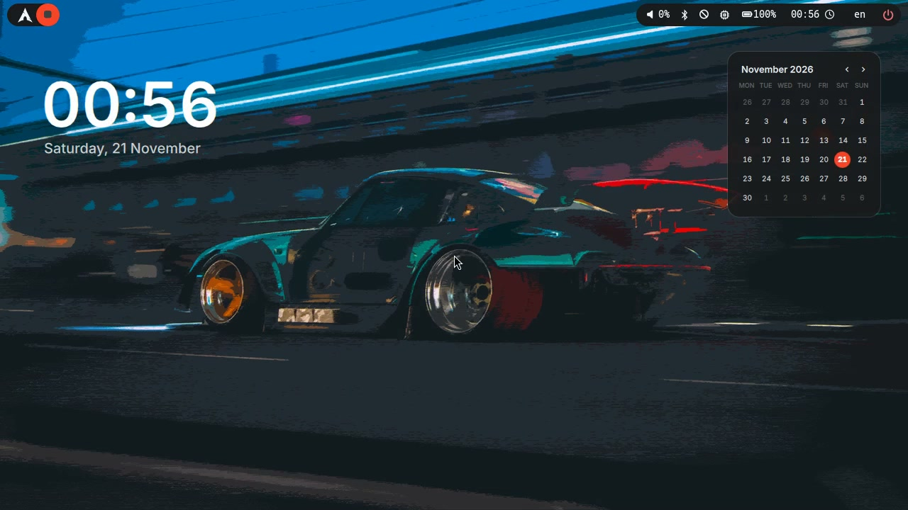

# Rymond044’s Hyprland dotfiles

My Arch Linux desktop runs Hyprland with a Lua configuration. Waybar adapts to each monitor’s logical width, Wallust builds a palette from the wallpaper, and two Quickshell apps handle search and desktop widgets.

## Showcase

[](docs/media/showcase.mp4)

[Watch the desktop recording (MP4)](docs/media/showcase.mp4) · 17 seconds, 720p. Search for Kitty, calculate an expression, open the session menu and add a calendar above a terminal. Recorded on an isolated Hyprland display with a demo widget layout.

## Around the desktop

| Shortcut | What it opens |
| --- | --- |
| Super + Space | [quickseek](https://github.com/Rymond044/quickseek) searches applications, evaluates expressions and finds files with the `f ` prefix. |
| Super + Shift + A | The control center inside quickseek, with sections for Wi-Fi, Bluetooth, sound, displays, power and appearance. |
| Super + V / Super + Esc | Clipboard history / session actions in quickseek. |
| Super + W | [quickdesk](https://github.com/Rymond044/quickdesk) raises desktop widgets above windows. Its editor saves a layout for each combination of monitors. |
| Super + Tab / Ctrl + Tab | HyMission’s overview of all workspaces / the current workspace. |
| Super + Shift + S | HyprCapture’s capture interface. |
| Super + arrow / Super + Shift + arrow | Move focus / move a window in that direction, crossing monitors at the edge. |

Split Monitor Workspaces gives each monitor its own set of workspaces. Changing the wallpaper updates the palette used by Waybar, the terminals, notifications and Quickshell. Light and dark modes can follow the wallpaper or be pinned. The desktop also includes a custom idle screensaver, a battery history viewer and terminal package pickers for pacman and the AUR.

## Install on Arch Linux

Start from an installed Arch system with a regular user and sudo access. Preview the base package selection first, then open the interactive installer to choose personal apps, optional features and hardware support. The MSI laptop profile is opt-in.

```sh
git clone --recurse-submodules https://github.com/Rymond044/dotfiles.git ~/dotfiles
cd ~/dotfiles
./dot plan
./bootstrap.sh
```

The [installation guide](docs/INSTALL.md) covers selection flags, first-login setup and recovery. The [package catalog](packages/scopes.json) defines what belongs to each installation scope.

## Repository map

| Where | What lives there |
| --- | --- |
| [hypr](hypr/.config/hypr) | Hyprland Lua modules, keyboard bindings, Hypridle and Hyprlock. |
| [quickseek](quickseek), [quickdesk](quickdesk), [cc](cc) | App settings and control-center integration. The two Quickshell apps themselves live in separate repositories. |
| [waybar](waybar), [swaync](swaync), [wallust](wallust), [quickshell](quickshell) | Bar layouts, notifications, palette templates and desktop panels. |
| [binc](binc/.config/binc) | Desktop commands for themes, wallpapers, locking and package management. |
| [kitty](kitty), [ghostty](ghostty), [nvim](nvim), [zsh](zsh) | Terminal, editor and shell configuration. |
| [system](system), [hardware](hardware), [session](session) | System files for `/etc`, hardware profiles and user-session defaults. |
| [install](install), [packages](packages) | Installer, package selection and service lists. |

User config packages mirror paths under `$HOME`. For example, GNU Stow links files from `hypr/.config/hypr/` into `~/.config/hypr/`. From the repository, use `./dot check` to verify links, `./dot sys diff` to compare tracked system files with `/etc`, and `./dot --help` for all commands. See the [Stow guide](docs/STOW.md) for the day-to-day workflow.
